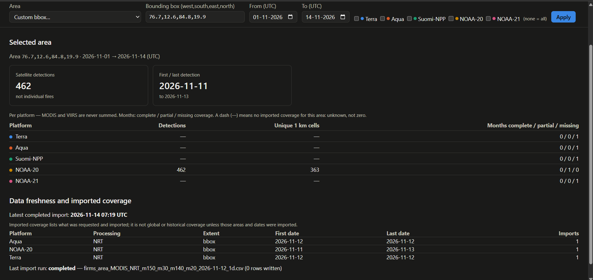
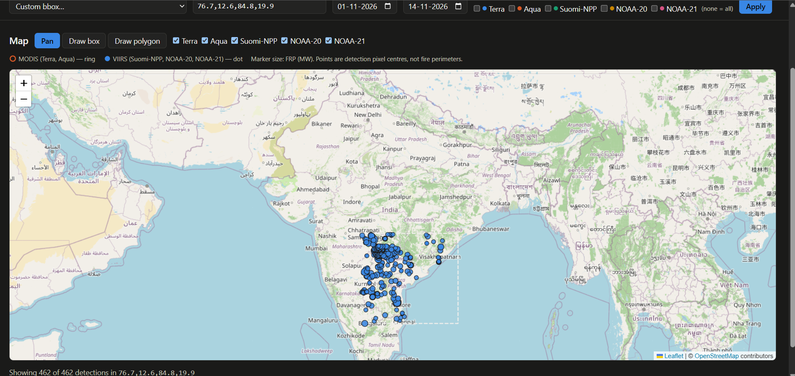
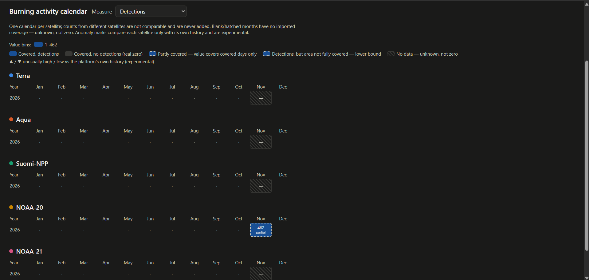
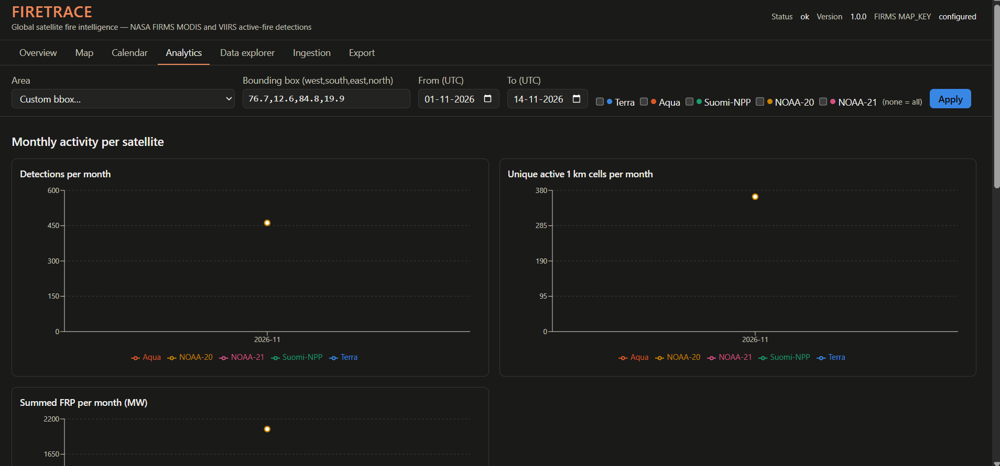
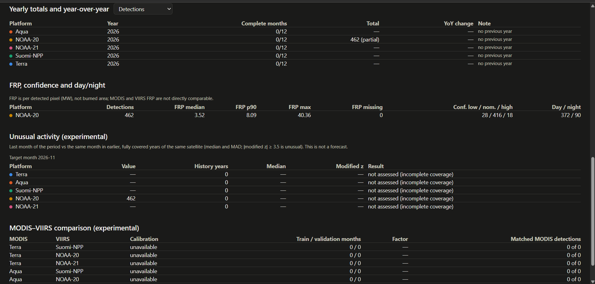
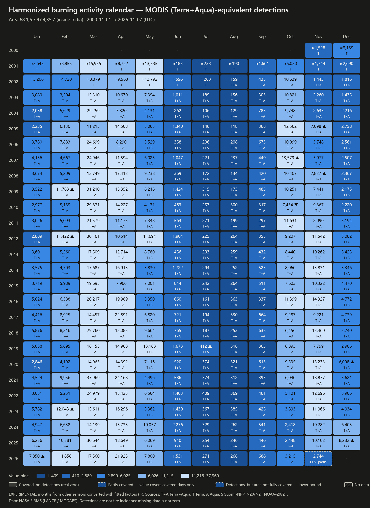

# FIRETRACE

[](https://www.python.org/)
[](https://fastapi.tiangolo.com/)
[](https://pandas.pydata.org/)
[](https://www.typescriptlang.org/)
[](https://react.dev/)
[](https://vite.dev/)
[](https://tailwindcss.com/)
[](https://leafletjs.com/)
<br>
[](https://firms.modaps.eosdis.nasa.gov/)
[](https://firms.modaps.eosdis.nasa.gov/)
[](PROJECT_PROGRESS.md)
[](CHANGELOG.md)
[](LICENSE)
[](docs/FINAL_REPORT.md)

**Fire Intelligence and Historical Activity Monitoring System** — a global
Earth-observation platform that integrates NASA FIRMS MODIS (Terra, Aqua; C6.1) and
VIIRS 375 m (Suomi-NPP, NOAA-20, NOAA-21; C2) active-fire detections into a
sensor-aware, harmonized historical burning-activity calendar for any area on Earth.

> Status: v1.1 — harmonized burning activity calendar, verified on Windows with 26 years
> of real FIRMS archive data for India (10.7 million MODIS and VIIRS detections; see
> `docs/validation/india_harmonization.md`). Coverage exists only for what was imported
> (`docs/DATA_PROVENANCE.md`). Harmonization, anomaly and cross-sensor analytics remain
> labelled experimental. Verified checkpoints:
> `PROJECT_PROGRESS.md`. Final report: `docs/FINAL_REPORT.md`.

## Scope

- Any country, first-level region, bounding box or custom polygon worldwide, including
  areas that cross the antimeridian.
- MODIS and VIIRS history from each sensor's earliest available record to the present.
- No built-in geographic restriction. Example regions (such as Andhra Pradesh, India)
  are optional presets only.
- **Coverage is reported, not assumed.** FIRETRACE only reports data coverage for
  sensors, areas and dates that have actually been imported and verified.

See `docs/architecture/ARCHITECTURE.md` and `docs/IMPLEMENTATION_PLAN.md`.

## Scientific ground rules

- Active-fire detections are not fire incidents; FRP is not burned area.
- Missing observations are never treated as zero activity.
- Raw MODIS and VIIRS counts are never added together without sensor-aware normalization.
- No synthetic data is ever presented as NASA observations. Test fixtures are labelled
  `SYNTHETIC TEST DATA`.

## Screenshots

Real data: 462 NOAA-20 VIIRS NRT detections, 2026-11-11 to 2026-11-13, over the
example area 76.7, 12.6, 84.8, 19.9 (see `docs/DATA_PROVENANCE.md`). Other satellites
show "—" or hatched months because no data was imported for them there.

| Overview | Map |
|---|---|
|  |  |

| Calendar | Analytics |
|---|---|
|  |  |



v1.1, real data — harmonized calendar for India, 2000-11 to 2026-11, exported from the
Calendar page (≈ marks months converted from Terra alone before Aqua's first record):



## Data sources

- **FIRMS Area API** (recent data and keyed backfill): needs a MAP_KEY.
- **FIRMS historical archive** (global history): yearly per-country CSV summaries and
  Archive Download Tool exports, imported from files.

## Layout

```
backend/   FastAPI service, ingestion, harmonization, analytics (Python)
frontend/  React + TypeScript + Vite dashboard
data/      raw/ (untouched source files), processed/ (partitioned store), samples/
docs/      architecture, science methodology, API, validation reports
```

Bulk work (archive import, API fetch, reports, exports, maintenance) uses the
command-line tools in `backend/app/cli/`, described below.

## Documentation

| Document | Contents |
|---|---|
| `docs/FINAL_REPORT.md` | What was built, data processed, validation and test results, limitations |
| `docs/DATA_PROVENANCE.md` | Data sources, how provenance is kept, real datasets processed |
| `docs/science/METHODOLOGY.md` | Scientific method overview and known limitations |
| `docs/science/` (ingestion, harmonization, analytics) | Detailed rules, formulas, references |
| `docs/architecture/` | Architecture, storage layout, FIRMS API findings, frontend |
| `docs/api/README.md` | REST API endpoints |
| `docs/validation/performance.md` | Measured performance |

## Configuration

Copy `.env.example` to `backend/.env` and set `FIRMS_MAP_KEY`. Credentials stay on the
backend and are never exposed to the frontend.

## Installation (Windows PowerShell)

Requirements: Git, Python 3.12, Node.js 24 (npm 11). No GPU or Docker needed.

The pinned versions below were verified on Windows on 2026-11-14, including a clean-clone
install with exactly these commands (all tests passed, no warnings).

```powershell
git clone https://github.com/maheshpedasingu/FIRETRACE.git
cd FIRETRACE\backend
py -3.12 -m venv .venv
.\.venv\Scripts\Activate.ps1
python -m pip install -r requirements.txt
cd ..\frontend
npm ci
```

If `Activate.ps1` is blocked, run `Set-ExecutionPolicy -Scope CurrentUser RemoteSigned` once.

## Running

Backend (terminal 1):

```powershell
cd backend
.\.venv\Scripts\Activate.ps1
python -m uvicorn app.main:app --reload --port 8000
```

Frontend (terminal 2):

```powershell
cd frontend
npm run dev
```

- Dashboard: http://localhost:5173
- Health check: http://127.0.0.1:8000/api/health
- API docs (OpenAPI): http://127.0.0.1:8000/docs

## Importing FIRMS files

From `backend/` with the virtual environment active:

```powershell
python -m app.cli.import_archive E:\path\to\firms_downloads
```

See `docs/architecture/storage.md` for options (platform, coverage bbox/country and dates).

**Archive Download Tool requests** (e.g. country India, MODIS + VIIRS S-NPP,
2000-11-01 to 2026-11-07) carry no coverage in their file names, so declare it exactly
as requested:

```powershell
python -m app.cli.import_archive E:\FIRETRACE_WORKSPACE\downloads\<file>.zip --country India --start 2000-11-01 --end 2026-11-07
```

Coverage is then clipped automatically to each satellite's FIRMS record (Aqua from
2002-07-04, Suomi-NPP 2012-01-20 to 2026-11-02, …) and split between standard (SP) and
near-real-time (NRT) records at the last SP day. In the dashboard, enter the country in
**Inside country** (or pick the India example) so the country coverage counts for the
area; use it only for areas that lie entirely inside that country.

## Fetching recent data from the FIRMS API

Needs `FIRMS_MAP_KEY` in `backend/.env`. From `backend/`:

```powershell
python -m app.cli.fetch_firms --availability
python -m app.cli.fetch_firms --source VIIRS_NOAA20_NRT --bbox 76.7,12.6,84.8,19.9 --start 2026-11-10 --end 2026-11-12
python -m app.cli.fetch_firms --source MODIS_NRT --world --start 2026-11-12 --end 2026-11-12
```

The bbox above is only an example area. See `docs/architecture/firms-api.md`.

## Area summary

From `backend/`: monthly detections and active 1 km cells per satellite for an area,
with coverage status (blank = no data, not zero):

```powershell
python -m app.cli.area_summary --bbox 76.7,12.6,84.8,19.9 --start 2026-11-01 --end 2026-11-14
```

## Dashboard

Choose an area (example, saved area, bounding box, or **Point + radius**), a period and
optional satellites. Pages: Overview (totals and imported coverage), Map, Calendar
(**Harmonized** one-calendar view in MODIS- or VIIRS-equivalent units, or one calendar
per satellite), Analytics, Data explorer, Ingestion and Export. Calendars and charts can
be downloaded as PNG or SVG; data as CSV with provenance.

## Checking time and memory for a large area

Before opening the dashboard on a very large area or long period, measure it from the
command line (read-only; stop with Ctrl+C):

```powershell
python -m app.cli.area_profile --bbox 68.1,6.7,97.4,35.7 --country India --start 2000-11-01 --end 2026-11-07
```

It prints the elapsed time and peak memory of each step the dashboard runs.

## Anomaly and validation report (experimental)

```powershell
python -m app.cli.anomaly_report --bbox 76.7,12.6,84.8,19.9 --start 2012-01-01 --end 2026-10-31 --target 2026-10
```

Needs several years of imported, fully covered data per platform; otherwise each
platform is reported as not assessed with the reason. Method: `docs/science/harmonization.md`.

## Exports

```powershell
python -m app.cli.export hotspots  --bbox 76.7,12.6,84.8,19.9 --start 2026-11-01 --end 2026-11-14 --out ..\exports\hotspots.csv
python -m app.cli.export calendar  --bbox 76.7,12.6,84.8,19.9 --start 2026-01-01 --end 2026-11-14 --out ..\exports\calendar.csv --grid
python -m app.cli.export analytics --bbox 76.7,12.6,84.8,19.9 --start 2026-01-01 --end 2026-11-14 --out ..\exports\analytics.json
```

Each file gets a `.provenance.json` sidecar. See `docs/science/analytics.md`.

## Maintenance and performance

```powershell
python -m app.cli.compact                 # merge small files, verify the store
python -m app.cli.compact --verify-only   # report only
python -m app.cli.benchmark --rows 2000000 --workdir ..\benchmark_work   # synthetic data, new folder
```

See `docs/validation/performance.md`.

## Tests and checks

```powershell
cd backend;  python -m pytest -q; python -m ruff check .
cd ..\frontend; npm test; npm run build
```

## License

Code: MIT (see `LICENSE`). NASA FIRMS data is not included in this repository; when you
use it, follow the NASA FIRMS citation and data-use policy.
